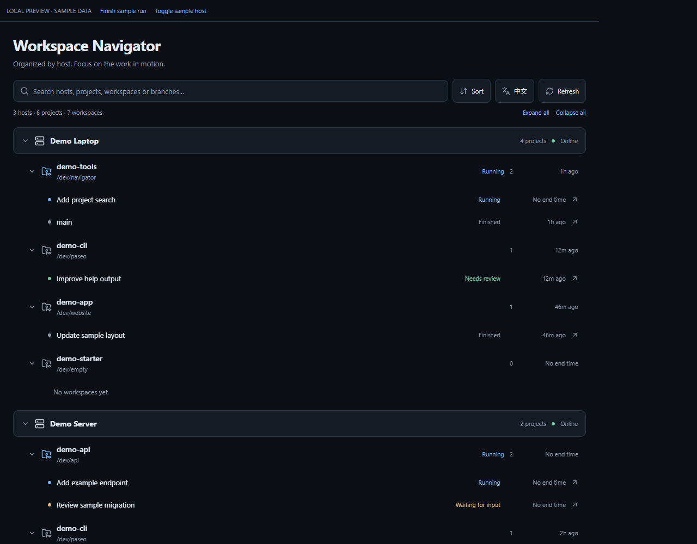
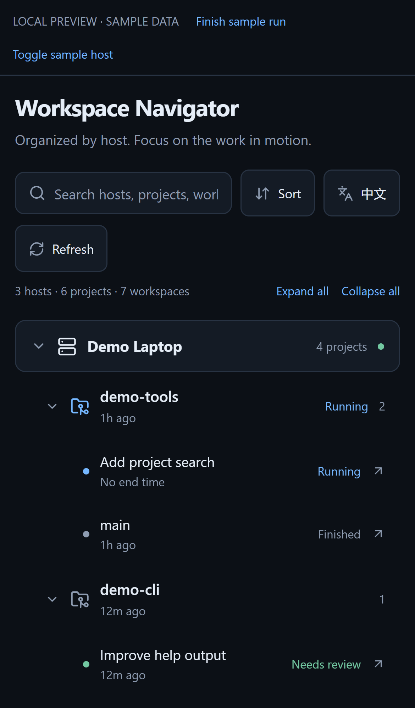

# Workspace Navigator

English · [简体中文](README.zh-CN.md)

A Paseo plugin that organizes workspaces as **Host → Project → Workspace**, with collapsible groups, search, and configurable execution-time sorting.

## Features

- Collapsible host and project groups with connection status.
- Default order: **running first, then latest execution end time**.
- A sort menu with execution end time or name, ascending or descending, and an independent running-first switch. The same rules apply to projects and workspaces; hosts keep Paseo's configured order.
- Search hosts, projects, directories, workspaces, and branches. Matches expand temporarily; clearing search restores the saved collapse state.
- Open a workspace on its owning host using Paseo's native navigation.
- Sort, collapse, and language preferences saved on the plugin host and shared by its clients.
- English and Chinese, compact phone layouts, and read-only display of previously loaded offline hosts.

## Installation

Requires **Paseo client and daemon 0.11.4 or newer**. Enable plugins under **Settings → your host → Plugins**, then enter this in **Plugin source** and select **Install plugin**:

```text
git:yeyan00/paseo-workspace-navigator
```

Or use the CLI:

```sh
paseo plugin install git:yeyan00/paseo-workspace-navigator
```

For local development, supply the absolute directory on the daemon machine, for example:

```powershell
paseo plugin install "C:\plugins\paseo-workspace-navigator"
```

Open **Workspace Navigator** from the sidebar or Command Center. Only the host serving the plugin needs it installed. The page can query other hosts configured and connected in the current client. The plugin host must remain available.

Plugins run as trusted code in the daemon and app. This plugin reads directory and execution metadata, opens workspaces, and saves its own display preferences. It does not read conversation bodies, send prompts, run shell commands, or archive or delete workspaces.

## Sorting

A project's end time is the latest reported end time among its visible workspaces. The plugin uses workspace completion/failure status-entry times and agent completion/error attention timestamps. Waiting for input does not count as completion.

The public API does not expose a complete execution-end history, so these are **best-effort timestamps**, not necessarily the exact time of the last message. Missing times always sort last, and tied times use name order. Creation, first discovery, opening, agent `updatedAt`, and streaming timestamps do not affect ranking.

## Mobile and limitations

Production code uses React Native and host-provided FlatList, TextInput, and Modal components, with no DOM or localStorage dependency. Phone layouts use compact rows and the host's modal presentation. Desktop and phone-sized browser interactions are tested; **native iOS and Android have not yet been device-verified**.

This plugin adds a separate navigation screen rather than replacing the built-in workspace sidebar. An offline host has no data on first load; only data already loaded in the current screen is retained. Closing the screen releases its subscriptions. Separate plugin installations keep separate preferences.

## Screenshots

These screenshots show the actual UI with **fictional sample hosts, projects, tasks, and paths**, not a live daemon. Preview controls are development-only.





## Development

Node.js 22.18+.

```sh
npm ci
npm run check
npm run test:browser
npm run check:package
npm run check:install
```

Browser checks use installed Microsoft Edge by default; adjust the channel in `playwright.config.ts` for another environment. Video recording requires `npx playwright install ffmpeg`.

```sh
npm run preview
```

Open `http://127.0.0.1:5178`. The preview uses fictional sample data and simulated host/settings adapters. It exercises the real UI, tree model, and subscription logic but is not a live-daemon integration test. Keep all preview data and screenshots fictional; do not use private project names, hostnames, user directories, or machine-specific paths.

`check:install` downloads a pinned official compiler revision, reproduces the former direct-type-import error, and compiles the plugin in an isolated checkout without `node_modules`. It then compiles the official client bundle to bytecode with React Native's Hermes compiler to check native JavaScript compatibility. It requires GitHub access.

After editing, run `paseo plugin reload workspace-navigator`. Use `paseo plugin logs workspace-navigator` to inspect load errors.

See the [verification record](docs/verification.md) and [registry publishing guide (Chinese)](docs/publishing.md).
